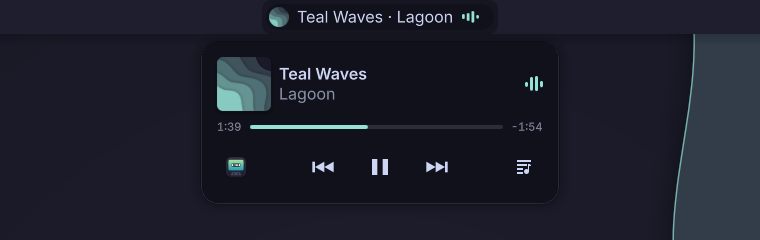

# Teal Pill

An island for KDE Plasma 6, in the spirit of the iPhone's Dynamic Island: a pill in the
panel with what is playing, and what else is going on. It works with every player that
speaks MPRIS: Spotify, Elisa, Haruna, mpv, Firefox, Chromium and Brave…



- **The pill**: the cover and bars that dance to the music; on hover, it widens to show
  the title, or keeps it shown if you choose so. Middle click plays or pauses, the wheel
  sets the volume, the mouse's back and forward buttons skip.
- **The card**, on click: the cover, the title and the artist; the progress between the
  times; previous, play/pause, next; a button that opens the player (right click: the next
  one, if several are open); the lyrics.
- **What else is going on**, each one can be turned off:
  - plugging the charger in or out widens the pill for a moment, in green, with the
    battery's level;
  - connecting headphones widens it for a moment, with their battery;
  - so does the power profile changing: `game-performance` holds it during a game;
  - colored dots, like the iPhone's: peach while an app records from a microphone, green while
    one uses a camera, mauve while the screen is shared or recorded;
  - a yellow dot, and a warning at the start, when the system was started from a snapshot;
  - copies and downloads get a bubble of their own beside the pill, their progress
    around it.
- **The cover's color**: the dancing bars and the progress take the cover's color, as the [Catppuccin](https://catppuccin.com) Mocha color of the same
  hue. Every album has its color, always within the palette; gray covers keep teal.
- **Synced lyrics**: from [lrclib.net](https://lrclib.net), a free and open database. Nothing
  is sent until you open them; then the song's title and artist are.
  The line being sung stays centered and lit.

Made for [Lagoon](https://github.com/elomkdn/lagoon-kde), at home in any Plasma
theme. In English and French.

## Install

Teal Pill needs only Plasma 6.

- **The release file**, offline: download `teal-pill.plasmoid` from the
  [releases](https://github.com/elomkdn/teal-pill/releases), then right-click a panel,
  *Add Widgets…*, *Get New Widgets…*, *Install Widget From Local File…*, and pick it. Or:

  ```sh
  kpackagetool6 -t Plasma/Applet -i teal-pill.plasmoid
  ```

- **A clone of the repository**:

  ```sh
  git clone https://github.com/elomkdn/teal-pill.git
  cd teal-pill
  ./install.sh
  ```

  To update: `git pull`, `./install.sh`, then log out and back in. To remove:
  `./install.sh --uninstall`.

Then right-click a panel, *Add Widgets…*, **Teal Pill**.

## Settings

| Setting | Default |
|---|---|
| Players to follow, picked among those open | the one playing |
| Show in the panel when nothing plays | no |
| Always show the title in the panel, not only on hover | no |
| Widest title in the panel | 220 px |
| Accent from the cover | yes |
| In the island: charger, transfers, microphone, camera, shared screen, headphones, power profile, snapshot | yes |

## Credits

Based on [PlasMusic Toolbar](https://github.com/ccatterina/plasmusic-toolbar) by Claudio
Catterina (GPL-3.0): `Player.qml`, which follows the MPRIS players, is his, unchanged. The
interface is new.

## License

[GPL-3.0-or-later](LICENSE).
